<div align="center">

<picture>
  <source media="(prefers-color-scheme: dark)" srcset="docs/img/wordmark-badge.png">
  
</picture>

### Your study squad's boss battle, right in Discord.

A pixel berry knight that turns a study group's Discord into a quiz game, and talks to each student's own Cubbie.


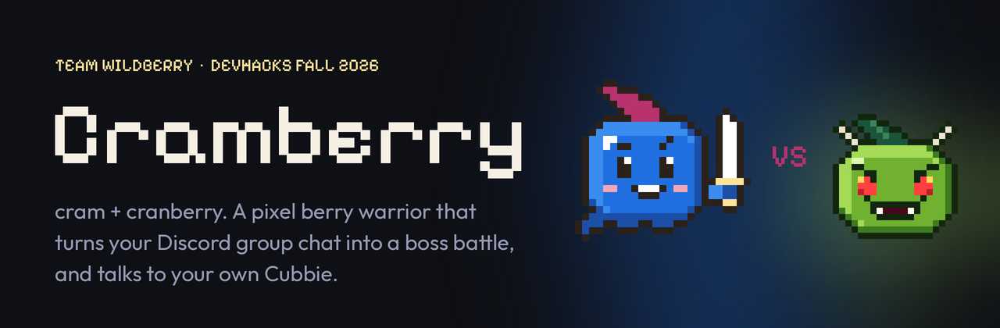

<sub>Team wildberry · Cubbie Hackathon, Track 3 (Group Chat Assistant) · DevHacks Fall 2026</sub>

**[Quick start](#quick-start)** · **[Full setup guide](SETUP.md)** · **[How Cubbie fits in](#how-cubbie-is-in-the-loop)**

</div>

---

## Why it exists

Studying alone is boring, group study turns into chatting, and nobody knows what the group *actually* doesn't
understand.

Cramberry makes the group chat itself the study session. Someone says *"im so cooked on caches"*, and two minutes
later the whole squad is fighting the Caches Boss together. Every right answer drains its HP; every wrong one lets it
hit back. When the fight ends, the squad sees its weakest topic, and each student's **Cubbie** quietly texts them
what *they* missed.

---

## How Cubbie is in the loop

<div align="center">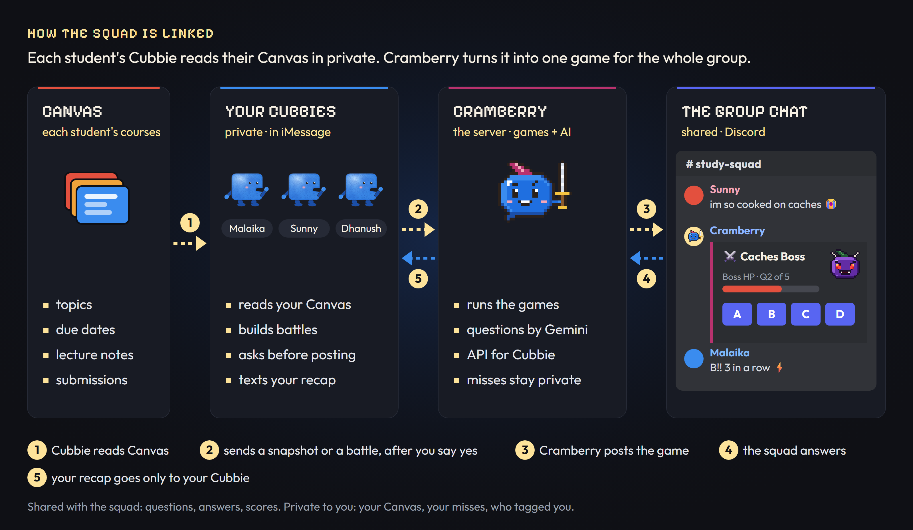</div>

| | |
|---|---|
| **Cubbie reads Canvas** | Each student links their Cubbie with `/link`. On every check-in it shares a small course snapshot: course codes, this week's topics, due dates and what's submitted. Never grades or files. |
| **Cubbie builds battles** | *"Challenge my squad on caches"* → Cubbie writes questions from that student's own course material, **asks them first**, then Cramberry posts the battle. |
| **Cramberry spots the moment** | From everyone's snapshots it notices *"3 of you have the midterm Thursday"* or *"the squad keeps missing associativity"* and offers a battle. |
| **Recaps stay private** | The group sees questions, answers and scores. Your misses and @mentions go only to your own Cubbie, through your private key. |

Cubbie can't receive messages, so it always comes to Cramberry, like checking a mailbox. Cramberry keeps only the
last ~20 chat messages in memory (never stored), and `/quiet` turns chat reading off. No Cubbie? Everything except
the Cubbie features still works.

---

## The games

| Game | How it plays |
|---|---|
| **Boss Battle** `/battle <topic>` | Everyone answers A–D. Right answers damage the boss; wrong ones let it hit the squad back. 3 in a row is a ⚡ critical hit, there's one 🎲 50/50 per battle, and the final strike lets you 💰 wager half or all in. |
| **Two Truths & a Lie** `/lie <topic>` | Three statements, one is a plausible misconception. Find the lie before the dragonfruit liar wins. |
| **Explain It** `/explain <topic>` | Cramberry calls on someone to explain a concept in their own words. The AI grades it 0–10 and says what to add. Pass, and it's open floor for half XP. |
| **Daily Duel** `/daily` | One question a day to keep your streak and the squad streak alive. `/daily 8pm` schedules it, `/daily off` stops it. |

<div align="center">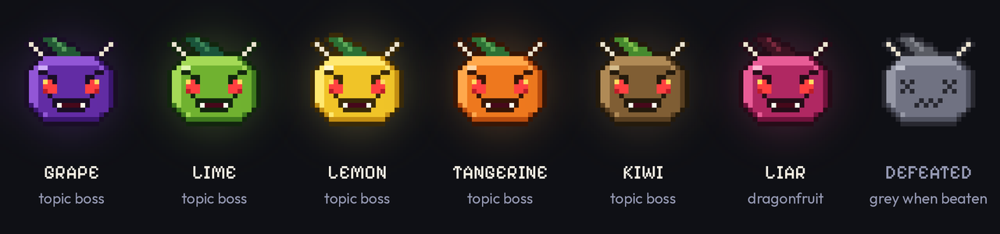</div>

Each topic gets its own fruit boss, and the same topic always gets the same one: caches is grape, recursion is
lime, TCP is lemon. Below 40% HP a boss gets a bandage; at zero it turns grey.

---

## What the squad sees

Every battle posts a picture card after each question, drawn live by the bot.

| | |
|---|---|
| 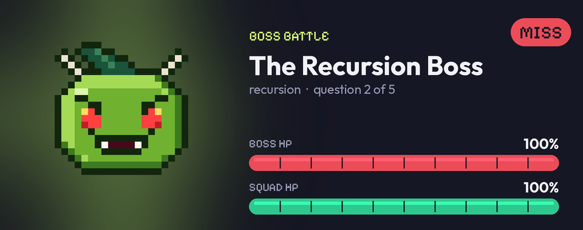 | 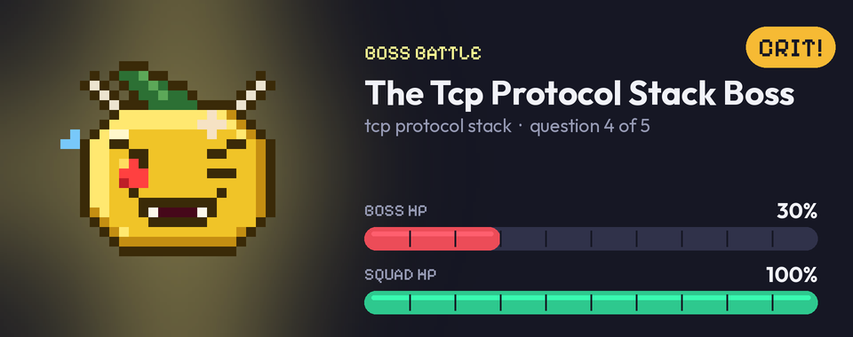 |
| **The battle.** The boss and both HP bars. | **Crit!** Three right in a row. The boss is hurt. |
| 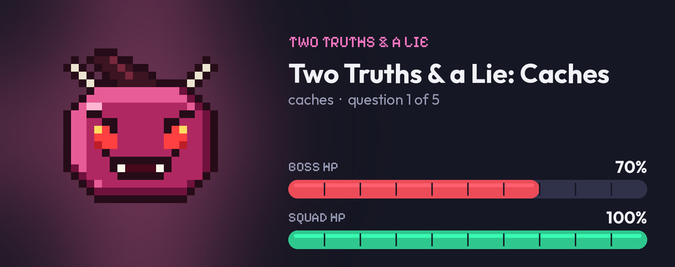 | 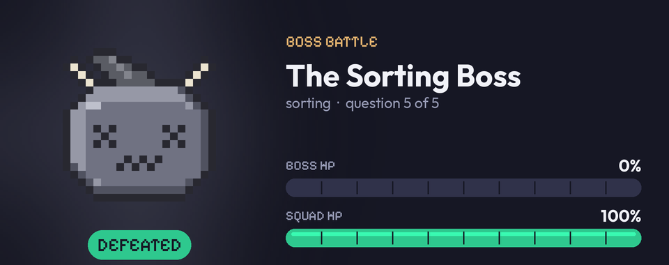 |
| **Two Truths & a Lie.** The dragonfruit liar. | **Defeated.** The boss goes grey. |
| 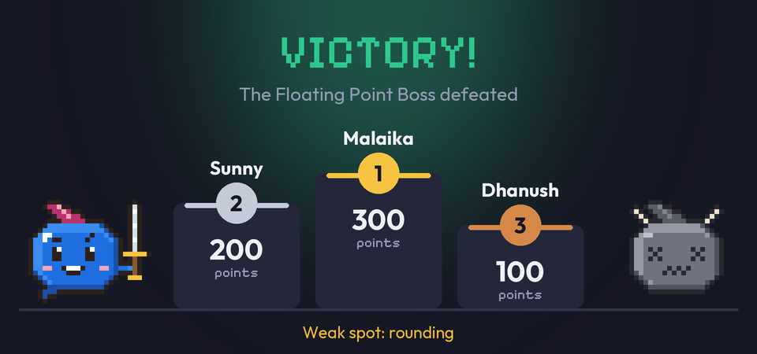 | 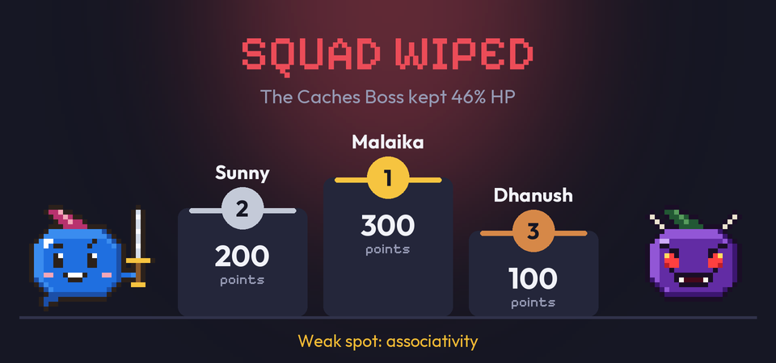 |
| **Victory.** The podium and the squad's weak spot. | **Squad wiped.** Run it back. |

---

## "im cooked"

Say you're cooked in the group chat (*"im cooked"*, *"gonna fail"*, *"send help"*) and Cramberry rallies the whole
squad instead of letting you spiral.

<div align="center">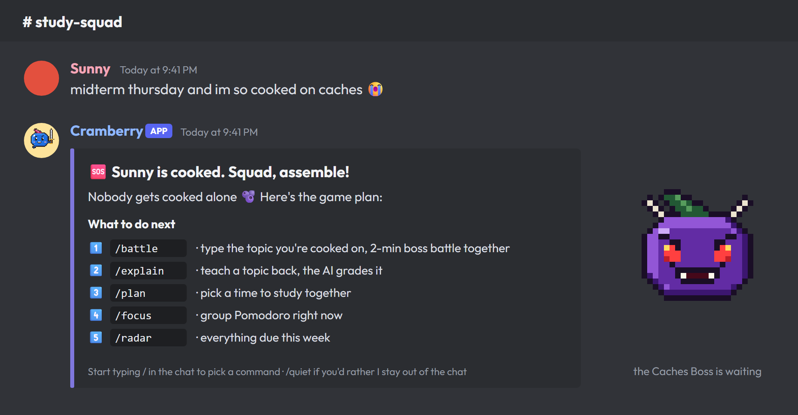</div>

It never guesses your topic, stays quiet during games, answers at most once every 5 minutes, and *"we cooked that
exam"* doesn't count.

---

## Study tools

| Command | What it does |
|---|---|
| `/plan <topic>` | A poll for a study time. The starter locks it, everyone going gets pinged 30 min before, and linked Cubbies offer to add it to Google Calendar. |
| `/focus [minutes]` | Group Pomodoro. Join, focus, get pinged at the break. |
| `/radar` | Everything due in the next 7 days across the squad (from linked Cubbies). Also posts every morning at 9. |
| `/notes` | Upload slides or notes (PDF, txt, md), and battles on those topics use them. |
| `/insights` | What Cramberry knows: courses, this week's topics, deadlines, weak spots. |
| `/profile` · `/leaderboard` | Level, XP, badges, streaks, accuracy. |
| `/link` · `/ask_cubbie <topic>` | Connect your Cubbie, or ask every linked Cubbie to build a battle from Canvas. |
| `/quiet` · `/watch` | Stop or allow reading the chat. |

<div align="center">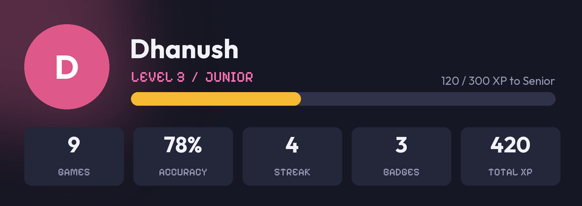</div>

Every game gives XP. Levels run from **Freshman** to **Professor**, and badges like Boss Slayer, Perfect Round and
High Roller show on `/profile`. Once a Cubbie has shared your courses, `/battle CSE230` means *your* CSE 230, not
another university's course with the same code.

---

## Quick start

```powershell
git clone https://github.com/MalaikaKamranKhan/Track3.git
cd Track3
python -m venv .venv
.venv\Scripts\python -m pip install -r requirements.txt
copy .env.example .env                     # add your DISCORD_TOKEN and DISCORD_GUILD_ID
.venv\Scripts\python -m squadbot.main
```

Then type `/battle caches` in your server. It runs without any AI key (`LLM_PROVIDER=fake` uses a built-in question
bank). Creating the Discord bot, AI keys, macOS/Linux commands, the HTTPS address for Cubbie, every setting and
troubleshooting are in the **[full setup guide](SETUP.md)**.

---

## Cubbie, from your phone

<div align="center"></div>

1. Text Cubbie the skill folder link (`…/tree/main/cubbie-skill/squad-link`) and reply yes.
2. Type `/link` in your Discord channel, then text Cubbie *"link my study squad"* and paste the key on its secure page.
3. *"Challenge my squad on caches"* → say yes → the battle lands in Discord. Afterwards: *"how did the squad battle go?"*

Details in [SETUP.md → Connect Cubbie](SETUP.md#7-connect-cubbie).

---

## Demo in 3 minutes

1. Sunny types *"midterm thursday, im so cooked on caches"* and Cramberry rallies the squad.
2. Malaika texts her **Cubbie** *"challenge my squad on caches from my CSE 230 notes"*, approves it, and *"📲 Malaika's Cubbie built this"* lands in Discord.
3. Judges press A–D on their own phones and watch the grape boss's HP drop and the podium form.
4. Malaika texts Cubbie *"how did we do?"* and gets a private recap with her missed question explained.
5. Show `/quiet` and the "asks before posting" step: privacy and consent built in.

---

## Under the hood

<div align="center">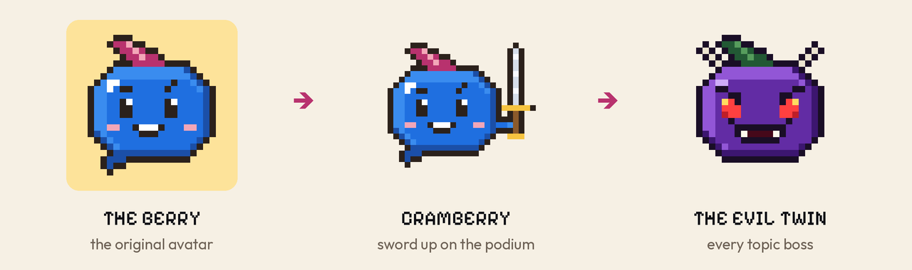</div>

Every character is one 24 × 24 pixel berry ([`squadbot/assets/mascot.svg`](squadbot/assets/mascot.svg)): give it a
sword and it's Cramberry, recolour it with horns and fangs and it's a topic boss. All of it is drawn from data at
runtime, so the cards stay sharp at any size.

```text
squadbot/main.py                 one process: Discord bot + scheduler + FastAPI for Cubbie
squadbot/runner.py               every game and feature, buttons, commands, the scheduler
squadbot/engine.py               battle rules: damage, crits, 50/50, wagers, weak topics, "im cooked"
squadbot/cards.py · images.py    every message as an embed, plus the Pillow picture cards
squadbot/sprites.py              Cramberry and the fruit bosses, built from assets/mascot.svg
squadbot/llm.py                  questions, lies, grading (Gemini, Claude, OpenAI, Bedrock, offline)
squadbot/insights.py             Cubbie snapshots, right-moment suggestions, /radar
squadbot/api.py                  the HTTPS API the Cubbie skill calls
squadbot/adapters/discord_bot.py slash commands, buttons, embeds
cubbie-skill/squad-link/         the Cubbie Skill: SKILL.md + a standard-library script
tests/                           27 offline tests, from battle rules to the full Cubbie loop over HTTP
```

---

## Team

Built in one weekend by **team wildberry**: **Malaika**, **Sunny** and **Dhanush**.

## License and credits

Code: [MIT](LICENSE) © 2026 team wildberry. Use it, change it, share it; just keep our names on it.

- **Cubbie** and its mascot belong to [Cubbie](https://hackathon.cubbie.ai/); they appear here to show how the
  hackathon pieces connect.
- Fonts: [Outfit](squadbot/assets/fonts/Outfit-OFL.txt) and [Pixelify Sans](squadbot/assets/fonts/PixelifySans-OFL.txt),
  both under the SIL Open Font License.

<div align="center">

---

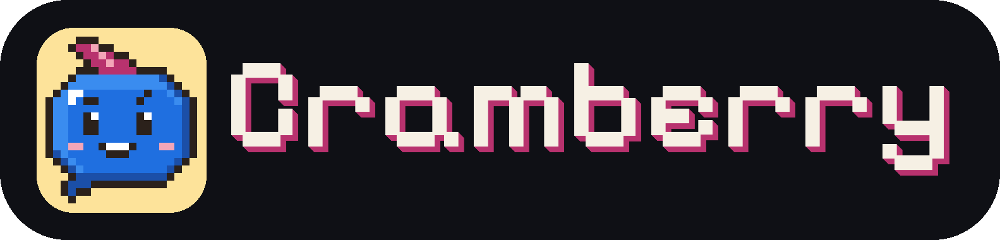

*Nobody gets cooked alone.*

</div>
