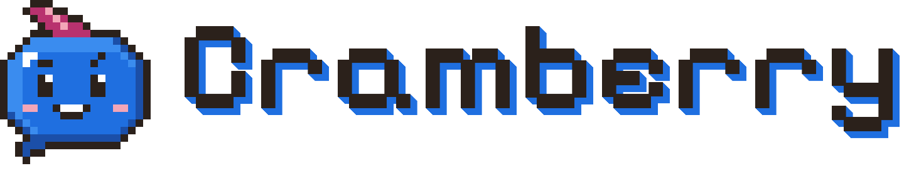
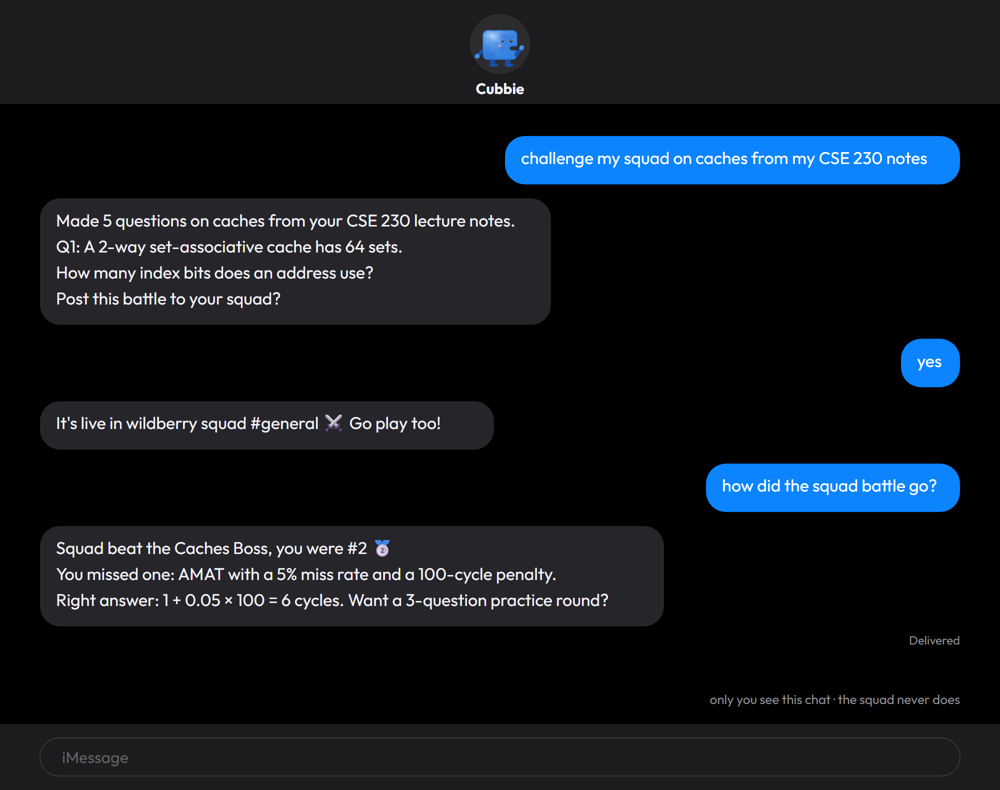

<div align="center">



# Setup guide

Run Cramberry in your own Discord server, then (optionally) connect your Cubbie.

</div>

About **20 minutes** end to end. Steps 1–5 get the bot playing in Discord. Steps 6–7 connect Cubbie.

| Step | What | Needed for |
|---|---|---|
| [1](#1-what-you-need) | What you need | everything |
| [2](#2-install) | Install | everything |
| [3](#3-create-the-discord-bot) | Create the Discord bot | everything |
| [4](#4-pick-an-ai) | Pick an AI | real questions (optional) |
| [5](#5-start-the-bot) | Start the bot | everything |
| [6](#6-give-it-an-https-address) | Give it an HTTPS address | Cubbie |
| [7](#7-connect-cubbie) | Connect Cubbie | Cubbie |
| [8](#8-run-the-tests) | Run the tests | developers |
| [9](#9-troubleshooting) | Troubleshooting | when something's off |

---

## 1. What you need

- **Python 3.10 or newer** ([python.org](https://www.python.org/downloads/)). Check with `python --version`.
- **A Discord server** where you can add bots (your own test server is perfect).
- **Optional:** an AI key (Gemini is free). Without one, Cramberry runs on a built-in caches question bank.
- **Optional:** a Cubbie account, to link your own Cubbie. Everything except the Cubbie features works without it.

---

## 2. Install

**Windows (PowerShell)**

```powershell
git clone https://github.com/MalaikaKamranKhan/Track3.git
cd Track3
python -m venv .venv
.venv\Scripts\python -m pip install -r requirements.txt
copy .env.example .env
```

**macOS / Linux**

```bash
git clone https://github.com/MalaikaKamranKhan/Track3.git
cd Track3
python3 -m venv .venv
.venv/bin/python -m pip install -r requirements.txt
cp .env.example .env
```

That installs discord.py, FastAPI, Uvicorn, httpx, pypdf and Pillow into a private `.venv` folder.
Your settings live in `.env`, which is never committed.

> Already have the repo? After every `git pull`, run the `pip install -r requirements.txt` line again in case a
> dependency was added.

---

## 3. Create the Discord bot

1. Open the [Discord Developer Portal](https://discord.com/developers/applications) → **New Application** → name it
   **Cramberry**. Upload [`docs/img/avatar.png`](docs/img/avatar.png) as the app icon.
2. **Bot** tab:
   - **Reset Token** → copy it into `DISCORD_TOKEN=` in `.env`.
   - Turn on **Message Content Intent** and save. Without it the bot can't see normal messages, so "im cooked",
     study-moment nudges and Explain It answers never fire.
3. **OAuth2 → URL Generator**:
   - Scopes: **`bot`** and **`applications.commands`**
   - Bot permissions: **Send Messages**, **Read Message History**, **Embed Links**, **Attach Files** (the picture cards are attachments)
   - Open the generated URL and add the bot to your server.
4. In Discord, turn on **Settings → Advanced → Developer Mode**, then right-click your server → **Copy Server ID** →
   paste into `DISCORD_GUILD_ID=`. Slash commands then appear in that server instantly instead of after up to an hour.

---

## 4. Pick an AI

Set these in `.env`. Leave `LLM_MODEL` empty to use the default model.

| Provider | Settings | Default model |
|---|---|---|
| **Offline** (no key) | `LLM_PROVIDER=fake` | built-in caches questions |
| **Gemini** (free key from [AI Studio](https://aistudio.google.com/apikey)) | `LLM_PROVIDER=gemini`, `GEMINI_API_KEY=...` | `gemini-3.5-flash-lite` |
| **Claude** | `LLM_PROVIDER=anthropic`, `ANTHROPIC_API_KEY=...` | `claude-haiku-5-5` |
| **OpenAI** | `LLM_PROVIDER=openai`, `OPENAI_API_KEY=...` | `gpt-4o-mini` |
| **AWS Bedrock** | `LLM_PROVIDER=bedrock`, normal AWS credentials, `AWS_REGION`; also `pip install boto3` | `amazon.nova-lite-v1:0` |

If a provider says the model doesn't exist, set `LLM_MODEL` to one your account lists.

---

## 5. Start the bot

```powershell
.venv\Scripts\python -m squadbot.main        # macOS/Linux: .venv/bin/python -m squadbot.main
```

Wait for `Discord bot online as Cramberry#…` in the log, then type `/help` in your server. Try `/battle caches`.

One process runs everything: the Discord bot, the scheduler (Daily Duels, the 9 AM radar, study reminders) and the
API on port 8000 that Cubbie talks to. Stop it with **Ctrl+C** in that terminal (press it twice if it keeps
waiting, or close the terminal).

> **One copy per bot token.** If two people run the same token at once, every command fails with
> "interaction failed" or is answered twice. Each developer should create their own test bot (step 3) and server.

**Where data lives:** XP, streaks, plans and Cubbie keys are saved in `data/state.json` on the machine running the
bot. To move hosting to another laptop, stop the bot and copy that file over.

### Every setting in `.env`

| Setting | Default | What it does |
|---|---|---|
| `DISCORD_TOKEN` | – | Your bot's token (step 3) |
| `DISCORD_GUILD_ID` | – | Server ID for instant slash commands |
| `BOT_NAME` | `Cramberry` | The name the bot uses for itself in messages |
| `PUBLIC_URL` | `http://localhost:8000` | Your HTTPS address (step 6) |
| `PORT` | `8000` | Port for the Cubbie API |
| `LLM_PROVIDER` · `LLM_MODEL` | `fake` · empty | AI provider and model (step 4) |
| `GEMINI_API_KEY` · `ANTHROPIC_API_KEY` · `OPENAI_API_KEY` · `AWS_REGION` | – · – · – · `us-east-1` | Provider credentials |
| `IMAGES` | `on` | Picture cards for battles, results and profiles |
| `QUESTIONS_PER_BATTLE` | `5` | Questions in a boss battle |
| `QUESTION_SECONDS` · `LIE_SECONDS` | `25` · `30` | Time per question |
| `WAGER_SECONDS` | `12` | Time to place the final-strike wager |
| `EXPLAIN_ROUNDS` · `EXPLAIN_SECONDS` · `OPEN_FLOOR_SECONDS` | `3` · `75` · `45` | Explain It pacing |
| `DAILY_SECONDS` · `DAILY_NOW_SECONDS` | `1800` · `90` | How long a scheduled / hand-started Daily Duel stays open |
| `NUDGE_COOLDOWN_MINUTES` | `30` | Minimum gap between "study moment" suggestions |
| `PANIC_COOLDOWN_MINUTES` | `5` | Minimum gap between "im cooked" rallies |
| `DATA_DIR` | `data/` | Where `state.json` is saved |

---

## 6. Give it an HTTPS address

Only needed for Cubbie: Cubbie calls your bot over the internet, so `localhost` isn't enough. Keep this running in a
second terminal while the bot runs.

**ngrok (recommended: the address never changes)**

1. Sign up free at [ngrok.com](https://ngrok.com), install it, and run `ngrok config add-authtoken <your token>`.
2. In the dashboard, open **Domains** and copy your free static domain.
3. Start the tunnel:
   ```powershell
   ngrok http --url=<your-domain>.ngrok-free.dev 8000
   ```

**cloudflared (no account; new address every restart)**

```powershell
cloudflared tunnel --url http://localhost:8000
```

Then:

1. Put the `https://` address in `PUBLIC_URL=` in `.env` and restart the bot.
2. Put the same address in `SERVER = "..."` at the top of
   [`cubbie-skill/squad-link/scripts/squad.py`](cubbie-skill/squad-link/scripts/squad.py), commit and push.
   Cubbie installs the skill from GitHub, so it only sees what's pushed.
3. Check it: open `https://<your-address>/health`. You should see `{"ok":true,"bots":["discord"]}`.

---

## 7. Connect Cubbie

<div align="center"></div>

1. **Install the skill.** Text Cubbie the link to the skill folder in your repo, for example
   `https://github.com/<you>/<repo>/tree/main/cubbie-skill/squad-link`, and reply **yes**.
2. **Get your key.** In your Discord channel, type `/link`. The key is shown only to you.
3. **Link.** Text Cubbie *"link my study squad"* and paste the key on Cubbie's **secure page**, never in the chat.
4. **Try it.**
   - *"check my squad"*: Cubbie shares your course snapshot. `/radar` and `/insights` now show your courses.
   - *"challenge my squad on caches"*: Cubbie writes questions from your Canvas material, asks you, then the battle
     appears in Discord.
   - After playing: *"how did the squad battle go?"* gets your private recap.

> **Renamed yourself in Discord?** Run `/link` again. Your key stays the same and Cubbie picks up the new name.

---

## 8. Run the tests

```powershell
.venv\Scripts\python -m pip install pytest
.venv\Scripts\python -m pytest -q tests
```

27 tests, about a minute, fully offline (fake AI, temporary data folder). They cover the battle rules, every game end
to end with simulated button presses, the picture cards, and the full Cubbie script → API → battle → recap loop over
real HTTP.

---

## 9. Troubleshooting

| Problem | Fix |
|---|---|
| Slash commands don't show up | Check `DISCORD_GUILD_ID` is your server, the invite included `applications.commands`, then restart the bot and reload Discord (Ctrl+R) |
| Every command says "interaction failed" | Another copy of the bot is running with the same token. Stop it (the bot shows online in the member list while it runs) |
| "im cooked" or Explain It answers do nothing | Turn on **Message Content Intent** (step 3), and check nobody ran `/quiet` (`/watch` turns it back on) |
| Battles post without pictures | Add the **Attach Files** permission to the bot's role, and check `IMAGES=on` |
| `ModuleNotFoundError: No module named 'PIL'` | Run the `pip install -r requirements.txt` line again |
| `PrivilegedIntentsRequired` on startup | Message Content Intent is off in the Developer Portal |
| `Improper token has been passed` | Reset the token and paste it again, with no quotes or spaces |
| `[Errno 10048]` / "address already in use" | Something else uses port 8000: stop it, or set `PORT=8001` (and point your tunnel at 8001) |
| Gemini returns 404 | The model name isn't available to your key: set `LLM_MODEL` |
| Cubbie says "server unreachable" | The tunnel or the bot isn't running, or `SERVER` in `squad.py` doesn't match your address (and isn't pushed) |
| Cubbie says "key rejected" | The key came from a different bot or `data/state.json` was reset: run `/link` and save the new key |
| Names look outdated | Names update the next time that person uses a command, sends a message or presses a button |

Still stuck? Open an issue with the last lines of the bot's log (remove any tokens first).
